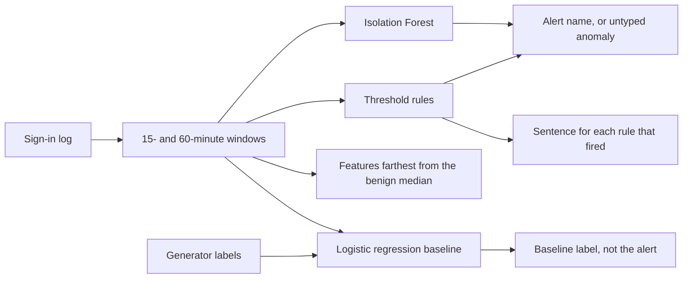

# LogSentinel

LogSentinel reviews an authentication log and flags sign-ins that deserve a second look: a brute-force burst, a password spray, credential stuffing, impossible travel, a site the user has never used, an off-hours success, a new device, or a success after a run of failures. Each alert names the rule that fired, or says that only the anomaly model fired, and lists the features that sit farthest from the benign baseline.

It is a companion to [PhishLens](https://github.com/OmMani47/PhisLens). PhishLens explains a single email. LogSentinel explains a row in a sign-in log. Both are study tools for Om, a cybersecurity and AI student. Both keep the score next to the reason, and both refuse to treat a perfect-looking number on synthetic data as a field result.

The holdout on this teaching log is not perfect. The operating detector's event-level F1 on the test window is **0.904**. It detects **18 of 20** attack campaigns. [Evaluation](#evaluation) is the section that says what those numbers are, which campaigns they miss, and what a reviewer should refuse to conclude.

## Ethics, first

Use this on logs you are allowed to read: your own lab export, a class dataset, or a range you were asked to review. Do not point it at an identity provider you do not operate. The tool does not log in, does not guess passwords, and does not ship a wordlist. The sample users live on `.example` domains. The sample addresses are the documentation ranges from RFC 5737 and RFC 3849 (`192.0.2.0/24`, `198.51.100.0/24`, `203.0.113.0/24`, `2001:db8::/32`).

An alert is not a reason to lock an account, reset a password, or accuse a person. It is a row to read. False positives bury a real shift. False negatives miss a takeover. Either one is a reason to keep a person in the loop. This is not a blocking control and it should not be dropped in front of a production IdP as one.

If a column in an uploaded file looks like a password, a token, or a secret, it is dropped before scoring and it is not shown.

## Portfolio pitch

The interesting part of detection is not a black-box label. A defender has to say what looked wrong: twelve failures in fifteen minutes, or a success 9,580 km from the previous one, twenty minutes later.

- Handwritten rules cover the patterns from an intro course. The thresholds are in the code and in the alert text. A person can audit them.
- Window features describe the same history the rules use: failure counts, distinct usernames on an address, distinct addresses for a user, a new user-agent, hours from this user's usual time, distance and speed since the previous success.
- Isolation Forest is fit only on benign rows from the opening week. It contributes a score. It does not invent the attack's name.
- Logistic regression is a supervised baseline fit on the generator's labels. It does not decide the alert. A real export does not have those labels. The baseline is there so the evaluation can show what a labelled linear model does, including where it fails to name the type.

That split is deliberate. A single opaque score would be easier to quote and worse to teach.

## How a decision is made



The label, the campaign id, and the scenario never enter the features. The forest is fit on rows the generator marked benign. The linear model is fit on the labels. Scoring a file that has no label column produces the same alerts.

A few design choices are worth knowing before you trust a flag:

- Counts include the current row, and only rows already seen. The tool does not look into the future.
- The brute-force rule is eight or more failures for one user in 15 minutes, and at most three usernames on that address. Six or seven failures, then a success, is a separate rule. A typo in this teaching log is one or two failures.
- Password spray is ten or more usernames from one address in 15 minutes, a failure ratio of at least 0.9, at most two failures per username, and at most two user-agents. The shared lab address tops out at eight students, so a class bell does not spray.
- Credential stuffing is either eight usernames and three or more user-agents, or one user failing from five or more addresses in 60 minutes.
- Impossible travel is a success at 800 km/h or more, at least 500 km away, within 180 minutes of the previous success. Speed is capped at 20,000 km/h for the model feature. The rule uses that same capped value.
- Unusual geography is a success at a site this user has not used, with at least six earlier successes, and a gap long enough that it is not the travel rule.
- Off-hours is a success at least seven hours from the user's usual time. Usual is the circular mean of earlier success hours, not a median. With the same number of morning and afternoon sign-ins, a circular median collapses onto one of the clusters and a 03:00 login stops looking late. The campus clock in this file is UTC, so 03:00 is the middle of the night.
- New device is a success from a user-agent and a device the user has not used, at a known site, during their usual hours. A new device at 03:00 is an off-hours alert. A new device at a new site is a geography alert.
- There is no 24-hour counter. A failure every 50 minutes never fills the 15-minute or 60-minute window. That gap is the slow-brute miss below.
- Nothing is geolocated. Latitude and longitude are columns. The sample's coordinates are fictional anchors so distance math has an input. They are not a claim about the documentation ranges, and the tool does not call a GeoIP service.

When several rules fire, the primary name follows a fixed order: spray, stuffing, brute force, success after failures, impossible travel, unusual geography, off-hours, new device. The alert still lists every rule that fired.

## What the demo is for

The sample log is two weeks at a fictional school: Northwind Campus, Harbor Annex, Westport Lab, and Ostport Relay. Twenty-eight people. One workstation each, which is a simplification. Students share `192.0.2.50` for a morning and an afternoon bell, so one address with several usernames is normal.

The Streamlit page scores that file. The opening morning flags a lot of first sign-ins. Those accounts have no earlier success in the file, so every identity feature is unseen. The forest threshold was chosen on a later slice, where that cold start is already over. Those rows are not in the test table.

The campaigns that matter for the score are in the last four days. Loud bursts are detected. Three situations are there on purpose because a defender will meet them:

- **slow-brute-test-1.** Eight failures for `grace.okello@northwind.example` from her own address, 50 minutes apart. No rule fires. The forest does not fire. The campaign is missed.
- **stealth-test-1.** `zoe.hart@library.northwind.example` fails once and then succeeds at 02:10, from her own desk, during the shift she works. It is the same shape as a typo. The campaign is missed. This is the result that should travel with the table.
- **tiny-spray-test-1.** Four usernames, one failure each, from one external address. The spray rule wants ten usernames, so it stays quiet. The forest flags all four, without an attack-type name.

The false alarms that the rules are built to raise are also in that window: a replaced laptop, an on-call success at 03:00, a walk over to Harbor Annex, and a first trip to Westport Lab. [Evaluation](#evaluation) counts them.

Northwind, Harbor, Westport, and Ostport are fictional. So are the people.

## Setup

Python 3.12. From the repository root:

```bash
python3 -m venv .venv
source .venv/bin/activate
pip install -r requirements.txt
```

The detector is already in `models/detector.joblib`, so you can score a log without training. Train again if you change the generator, the features, or the rules:

```bash
python -m src.generate   # rewrite the CSV and JSON, seed 42
python -m src.train      # fit, choose the threshold, write metrics
```

Run the tests and the app:

```bash
python -m pytest
streamlit run src/app.py
```

The app binds to port **8765** (see `.streamlit/config.toml`). Open [http://127.0.0.1:8765](http://127.0.0.1:8765). Scoring stays in this process. Nothing is uploaded.

## Reproducibility

[](https://github.com/OmMani47/LogSentinel/actions/workflows/tests.yml)

`.github/workflows/tests.yml` runs on every push and every pull request. The job installs `requirements.txt` on Python 3.12 and runs `python -m pytest`. That is the whole job. There is no lint step, and the job does not retrain. The tests load the committed log and `models/detector.joblib`.

The same check locally, from the repository root, after the venv above:

```bash
python -m pytest
```

Python 3.12 is the version CI uses.

Seed 42 is the regenerate and retrain path. Use it when the data or the features change, then run the tests again:

```bash
python -m src.generate   # rewrite data/sample_auth_logs.csv and the JSON sibling
python -m src.train      # fit on the opening window, set the threshold, save the model
python -m pytest
```

`src.generate` rewrites the teaching log and checks its own campaigns: a scripted burst must fire its rule, and the slow brute, the tiny spray, and the stealth takeover must fire none. `src.train` overwrites `models/detector.joblib` and `models/metrics.json`. What those scores mean is in [Evaluation](#evaluation). This section only says how to rebuild them.

The badge reports the latest run of this workflow on the default branch of `OmMani47/LogSentinel`. Until the workflow file is on that branch, the badge has no status. A pull request run is listed on the Actions tab.

## Command line

Score the built-in demo. It is a short file, not the evaluation log: a brute-force burst, a two-failure typo, and a night-shift takeover that looks routine.

```bash
python -m src.score --demo
python -m src.score --demo --format json
```

The first row for the night-shift user is an untyped anomaly. That account has no earlier success in the demo file, so the user-agent, device, and address are all unseen. The stealth pair at the end, after several nights at the same desk, is listed under `Generator labels with no alert`. The burst is named `brute_force_burst` once the eighth failure lands. The two failures before an ordinary success are not an alert.

Score a log you already have. CSV and JSON both work. The file needs `timestamp`, `username`, `src_ip`, `user_agent`, `device_id`, `site`, `latitude`, `longitude`, and `outcome` (`success` or `failure`). This tool does not geolocate IP addresses.

```bash
python -m src.score --file data/sample_auth_logs.csv
python -m src.score --file data/sample_auth_logs.json --format json --output alerts.json
python -m src.score --file data/sample_auth_logs.csv --format csv --output alerts.csv
```

`--all-events` includes rows that did not alert. Alerts are not an error. A bad file exits 2.

## The app

`streamlit run src/app.py` opens the sample log. Upload replaces it. The page shows:

- Event count and alert count.
- Alerts by day, and alerts by primary reason.
- A table, and a selector that prints each rule sentence, the feature gaps versus the benign median, and the supervised baseline.
- A section, **Generator labels with no alert**, when the file has labels. On the sample, that section includes `slow-brute-test-1` and `stealth-test-1`.

The sidebar prints the test precision, recall, and F1 from `models/metrics.json`, and the same disclaimer as the evaluation section. Those three numbers are the later test window. They are not a count of every highlighted row in the file. The opening morning is outside that window.

A generator label, when the column exists, is shown as a label. The detector does not read it.

## Evaluation

Read this before the score table. The figures are from the committed run in `models/metrics.json`. They answer one narrow question: on a later slice of a log that was built with known gaps, how did the rules and the forest do, and how did a labelled linear model do at naming the type?

Scores are from a later time slice of a synthetic teaching log. They are not an estimate of accuracy on real authentication logs.

### How the split is built

`python -m src.train` loads `data/sample_auth_logs.csv` and cuts it by time. It does not shuffle.

- The file has **1080** synthetic sign-ins, from **2026-01-05** through **2026-01-19** (the end instant is excluded). Seed **42**.
- **Fit** is the half-open interval `[2026-01-05, 2026-01-13)`. **589** events. Isolation Forest is fit on the benign rows in this window only. Logistic regression is fit on every row in this window, labels included.
- **Validation** is `[2026-01-13, 2026-01-15)`. **184** events. It is used once, to pick the forest threshold that maximizes F1 of "rules or score" on this slice. Ties prefer the higher threshold. The logistic baseline is not tuned here.
- **Test** is `[2026-01-15, 2026-01-19)`. **307** events: **137** labelled attacks and **170** benign. This slice is scored once. It is the table below.
- There is no cross-validation and no second untouched holdout. The validation F1 in `models/metrics.json` (`validation_operating.f1`) is how the threshold was chosen. It is not a second test, and it is not the number to quote.

Campaigns are written so they fall entirely inside one slice. A burst in the test window was not seen, as that burst, during fit. The same kinds of bursts do exist in the fit window, so the linear model has seen the pattern. The forest has not been shown attack rows at all.

`src.generate` checks the log before it is written. Every address is in a documentation range. Every username ends in `.example`. A benign row has at most two failures in 15 minutes and does not fire a burst rule or the travel rule. Each scripted campaign either fires the rule it was written for, or it is one of the quiet campaigns: slow brute, tiny spray, stealth takeover.

### The score on the test window

The operating detector alerts when any rule fires, or when the forest score is at least the validation threshold. The positive class is "the generator marked this row as an attack," of any type.

| Detector | Precision | Recall | F1 |
| --- | ---: | ---: | ---: |
| Rules only | 0.899 | 0.453 | 0.602 |
| Isolation Forest only | 0.944 | 0.854 | 0.897 |
| Rules or forest | 0.911 | 0.898 | 0.904 |
| Logistic regression, attack vs benign | 0.843 | 0.978 | 0.905 |

Operating detector, event counts. Rows are the truth, columns are the decision.

|  | No alert | Alert |
| --- | ---: | ---: |
| Benign | 158 | 12 |
| Attack | 14 | 123 |

Campaign recall is **0.900**: **18** of **20** test campaigns produced at least one alert. A campaign is one scripted incident, not one row. The two misses are `slow-brute-test-1` and `stealth-test-1`.

### Per attack type

Two recalls are reported because they answer different questions.

**Typed recall** asks whether the primary rule name matches the generator's type. An early failure in a burst is often flagged by the forest with no rule name (`untyped_anomaly`). That row counts as a miss for the type, and as a hit for the event-level table above.

**Any-alert recall** asks whether the row produced an alert at all.

Precision is typed: of the rows given this name, how many really were this type.

| Type | Support | Precision | Recall | F1 | Any-alert recall |
| --- | ---: | ---: | ---: | ---: | ---: |
| brute_force | 40 | 1.000 | 0.450 | 0.621 | 0.800 |
| password_spray | 36 | 1.000 | 0.389 | 0.560 | 1.000 |
| credential_stuffing | 34 | 1.000 | 0.559 | 0.717 | 1.000 |
| impossible_travel | 2 | 1.000 | 1.000 | 1.000 | 1.000 |
| unusual_geography | 2 | 0.500 | 1.000 | 0.667 | 1.000 |
| off_hours | 2 | 0.500 | 1.000 | 0.667 | 1.000 |
| new_device | 3 | 0.500 | 1.000 | 0.667 | 1.000 |
| success_after_failures | 16 | 1.000 | 0.125 | 0.222 | 0.750 |
| stealth_takeover | 2 | 0.000 | 0.000 | 0.000 | 0.000 |

How to read the awkward cells:

- Brute-force typed recall is 0.450 because the rule starts at the eighth failure. Each loud burst is 16 failures, so nine rows get the name `brute_force_burst` and the earlier rows do not. The forest still flags those earlier rows, which is why any-alert recall is 0.800. The remaining gap is the eight-row slow burst, which nobody flags. Typed precision stays 1.000: when the rule says brute force, the row is brute force.
- Spray and stuffing have the same shape. The rule names the rows after the threshold. The forest names nothing, but it does flag the ramp, and it flags `tiny-spray-test-1`, which the rule cannot see. Any-alert recall for spray is 1.000. Typed recall stays low.
- Success-after-failures typed recall is 0.125 because only the successful row is in the six-or-seven band. The failures in front of it are the attack too, and they are not given that name. Two campaigns, one named row each, out of 16 rows.
- Impossible travel is two successes, both named correctly, precision 1.000. The support is two. The generator placed them at about 9,580 km in 20 minutes. The rule was written for that. A perfect cell here means those two rows were separable. It does not mean the rule has been measured on travelers.
- Unusual geography, off-hours, and new device are recalled completely and are only half precise. The false names are the life events below.
- Stealth takeover has no rule and no forest alert. Precision, recall, F1, and any-alert recall are all 0.000. Support is two.

### What the logistic baseline does

The baseline is multinomial logistic regression on the same features, class-weighted, fit on the fit window only. On the test window its binary F1 (any attack type versus benign) is **0.905**, close to the operating detector, with higher recall and lower precision.

Its type names are a different story. On the test slice it never predicts the class `brute_force`. Precision, recall, and F1 for that class are **0.000**. The forty brute-force rows are filed under `success_after_failures` or `credential_stuffing`. The largest weight toward `brute_force` is `fail_count_user_60m` (about +0.99), and the largest weight against it is `prior_successes` (about −1.77). Shared failure features, plus a class that is easy to confuse with its neighbors, and the name disappears. The rules still say brute force when the count crosses eight. That is the argument for keeping the rule next to the model.

| Type | Precision | Recall | F1 |
| --- | ---: | ---: | ---: |
| brute_force | 0.000 | 0.000 | 0.000 |
| password_spray | 1.000 | 0.861 | 0.925 |
| credential_stuffing | 0.630 | 1.000 | 0.773 |
| impossible_travel | 1.000 | 1.000 | 1.000 |
| unusual_geography | 0.667 | 1.000 | 0.800 |
| off_hours | 0.500 | 1.000 | 0.667 |
| new_device | 0.500 | 1.000 | 0.667 |
| success_after_failures | 0.224 | 0.812 | 0.351 |
| stealth_takeover | 1.000 | 0.500 | 0.667 |

The stealth cell is not a quiet victory. Support is two rows. The model names the success and misses the failure in front of it, and it does not use a signal a person can check. The operating detector, which ignores this baseline, misses both rows. Trust that miss over the 0.667.

A few weights match the rules, which is what a linear model on these features should do:

| Class | Feature | Coefficient |
| --- | --- | ---: |
| off_hours | hour_deviation | +1.653 |
| new_device | unseen_ua | +0.936 |
| new_device | unseen_device | +0.873 |
| impossible_travel | geo_speed_kmh | +0.847 |
| unusual_geography | geo_distance_km | +0.807 |
| unusual_geography | unseen_site | +0.624 |

### False positives in the test window

Twelve benign rows alert. Seven are the rules doing what they were written to do:

- `fp-laptop-test-1`, `fp-laptop-test-2`, `fp-laptop-test-3`. A new laptop for Hiro, Leo, and Ines, at their usual desk, during the day. The new-device rule cannot tell this from the three malicious new-device rows. The linear model cannot either. Precision 0.500 is that tie.
- `fp-oncall-test-1`, `fp-oncall-test-2`. Leo and Ben sign in at about 03:00 from their own machines. The off-hours rule has no on-call calendar. Precision 0.500 is that tie.
- `fp-annex-test-1`. Elena signs in at Harbor Annex, a few kilometers from campus, hours after her previous success. The site is new to her, so unusual geography fires. The linear model's argmax on that row is benign.
- `fp-travel-test-1`. Chioma's first sign-in at Westport Lab, a day and a half after her previous success. The travel rule stays quiet because the gap is long and the speed is low. Unusual geography fires because the site is new. The linear model's argmax is benign. Ada's second trip to the same lab, later in the file, does not fire the rule: the site is already known.

Five more benign rows are the forest alone. Ada's later sign-in at Westport, a site she had already used, Chioma's next-morning return to campus, and Kira's next-day return to campus are all under 800 km/h, so the travel rule is quiet, and the distance is still far from the benign median of 0. Theo's single failure at the lab, and one of Elena's failures the morning after the annex visit, sit just above the threshold. The linear model calls these five benign.

One more disagreement runs the other way. David's next-day return to campus, after the Ostport success, is labelled `unusual_geography` by the linear model and left alone by the rules and the forest. Distance is a useful feature and a blunt one. The rule asks for speed. The model asks for kilometers.

### What these scores mean

The operating F1 of 0.904 means that, on this later slice, the rules and the forest together separated most labelled attack rows from most benign rows, with 12 false alerts and 14 misses at the row level. The campaign recall of 0.900 means 18 incidents produced a row a person would see. The typed F1 numbers are lower where the rule waits for a threshold, and where a benign life event uses the same signal as an attack.

The gaps were drawn on purpose. Benign routine never reaches eight failures in 15 minutes. The lab never puts ten usernames on one address. The travel successes are absurd speeds. The new laptops, the on-call nights, the annex visit, the slow brute, and the stealth takeover were written to overlap ordinary behavior. A model that scores 1.000 on all of that would be a model that had been shown the answer key, or a generator that had removed the overlap.

### What these scores do not mean

`models/metrics.json` stores the caveat in `disclaimer`: scores are from a later time slice of a synthetic teaching log. They are not an estimate of accuracy on real authentication logs. The Streamlit sidebar prints that same sentence beside the F1, so the page does not show **0.904** alone.

A reviewer should refuse the neighboring claims as well.

- The probabilities from the linear model are not a calibrated risk. Several classes have a handful of rows.
- The number is one time cut of one synthetic file. It is not cross-validated, and it is not a result on logs the generator did not write.
- Real sign-in traffic has VPN exits, phone handoffs, travelers, contractors, and attackers who stay under a 60-minute window on purpose. This detector is not ready to sit in front of a real IdP.
- The tool does not see MFA results, password-breach corpora, device posture, or IP reputation. It must not. Reputation lookups and breach corpora are out of scope for a teaching repo, and the sample addresses are documentation ranges that have no honest reputation.
- Impossible travel at F1 1.000 is two rows. Stealth takeover at F1 0.000 is the result that should be quoted with it.
- Cold-start flags on the first morning of the file are real alerts in the app and are outside the test table. Do not mix the two counts.

## Layout

```text
data/sample_auth_logs.csv    1080 teaching sign-ins
data/sample_auth_logs.json   the same rows
data/demo_log.csv            the short CLI demo
src/generate.py              deterministic log, seed 42, and the campaign audit
src/features.py              windows and threshold rules
src/geo.py                   haversine and fictional site anchors
src/explain.py               rule sentences and feature gaps
src/model.py                 Isolation Forest, logistic baseline, metrics
src/train.py                 fit, threshold, save
src/score.py                 score a file
src/app.py                   Streamlit review
models/detector.joblib       fitted detector
models/metrics.json          the tables above
tests/                       rules, audit, evaluation honesty, CLI, app
.github/workflows/tests.yml  pytest on Python 3.12
```

CSV columns: `event_id`, `timestamp`, `username`, `src_ip`, `user_agent`, `device_id`, `site`, `latitude`, `longitude`, `outcome`, `label`, `campaign_id`, `scenario`. The model reads the operational columns and the windows it computes from them. `label`, `campaign_id`, and `scenario` are for the teaching evaluation and the "no alert" section.

Regenerate with `python -m src.generate`. The generator checks its own work before it writes.

## Limitations

- The log is synthetic. The overlap that exists is the overlap that was written in. Real attackers and real travelers are not required to respect it. These scores are not an estimate of accuracy on real authentication logs.
- Windows are 15 and 60 minutes. `slow-brute-test-1` is the proof that a 50-minute spacing walks through them.
- `stealth-test-1` is a takeover with no feature left to see. No model on these columns should be expected to catch it. A detector that did would be fitting noise.
- New device versus a replaced laptop, off-hours versus on-call, and a new site versus a partner lab are ties until someone adds an inventory, a calendar, or an allow-list. This repo has none of those.
- The forest threshold was chosen to lift validation F1, which rewards flagging the early rows of a burst. It also flags some return trips the speed rule correctly ignores, and it flags cold-start rows at the beginning of a file.
- The linear baseline's type names fail on brute force in this fit. Do not deploy those names as the alert.
- Coordinates have to be in the file. Guessing them from the IP would be wrong for documentation ranges and would be a network call this tool does not make.
- One workstation per person is a simplification. A second phone that appears mid-semester will look like a new device until it has been seen.
- False positives bury a shift. False negatives miss a takeover. This is a review aid, not a control that should disable accounts.

## Roadmap

- A 24-hour failure counter, so a slow burst is visible without pretending the 15-minute rule saw it.
- An on-call calendar and a device inventory supplied by the operator, so the off-hours and new-device rules can be suppressed on purpose.
- A partner-site allow-list, so a known lab does not stay "unusual" forever, and a first visit can still be reviewed.
- A wider quiet period after a far success, so the forest is less eager about the trip home. The rule already handles that case. The score does not.
- A local adapter for an IdP export the operator is allowed to read. Still no credential storage, and still no live login.

## Tests

```bash
python -m pytest
```

GitHub Actions runs this same command on Python 3.12. See [Reproducibility](#reproducibility).

The suite checks the rules on small hand-built logs, the documentation ranges and `.example` names, the generator's campaign audit, and the saved detector's verdict on the loud campaigns and on the misses. `slow-brute-test-1` and `stealth-test-1` must produce no alert. `tiny-spray-test-1` must produce no spray rule and must still alert. Dropping the label column must not change the alerts. The evaluation tests require the disclaimer, the time split, and this file's account of 0.904, including the brute-force baseline at 0.000 and the stealth miss. A high F1 is not, by itself, a passing grade.
